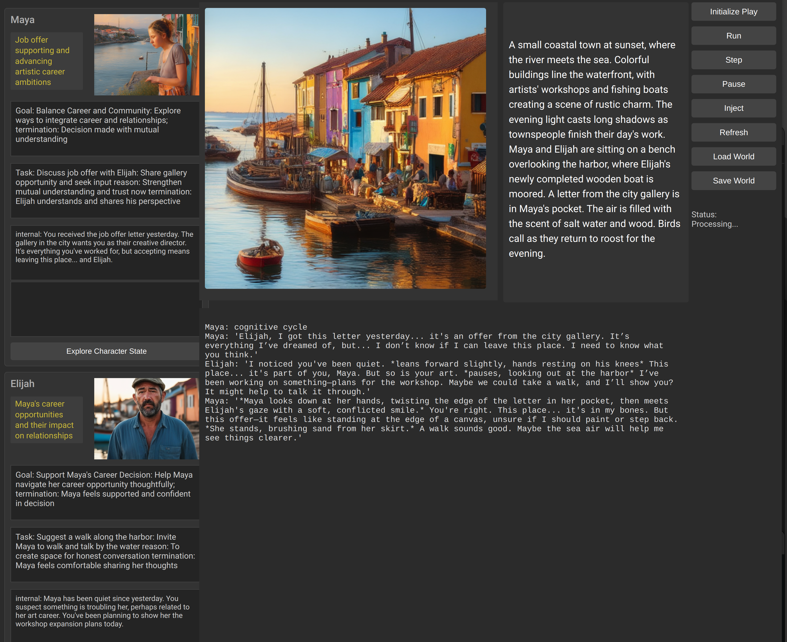

## ImprovAI[^1]: All the World's a Play

### Back in development (November 2026)

Version 3.0 of this README said I had probably reached the end of what the architecture could do. I was wrong about that, or at least early. After sixteen months away I came back, ran `lost`, handed the transcript to a writing instructor, and got a C. The characters were not the problem. The play kept contradicting itself: a man offered water he did not have, a boar was struck five times after it had run off, a shoulder was bandaged on a body the world said was unhurt.

So this is an overhaul, in progress. It is now on `main`, and it is not finished. This page says what has changed, what works today, and what does not.

cheers - Bruce

### What it is

ImprovAI is a stage for improvised plays performed by AI actors. Given a short scenario, it:

- builds a cast of cognitively deep characters, each with drives, memory, emotional stance, goals and plans (my main research interest);
- lets each character choose how to act at the Act, Scene, Goal, Task and Action levels;
- coordinates them through a Director into a narrative of acts and scenes;
- lets a human take the Director's chair at any of those levels, for any character.

Underneath is a small simulated world the actors live in. That world is where most of the new work has gone.



Older sample replays are at [demo](https://demo.tuuyi.com), with more background in the [slide show](http://www.tuuyi.com). Both predate the overhaul.

### What the overhaul is about

**The world is the authority.** The old engine let every LLM call write freely about the world, then fed that text back to every other call as the situation. Whatever a narrator once wrote was true from then on. The new rule is that the world keeps the record and everything else is held to it.

- **A world that keeps count.** Each play runs in a world (forest, farm, city, lunar base and others) that tracks bodies (thirst, hunger, fatigue, injury), what each character carries, places and what can be done at them, what has been used up, and dangers. Eating, drinking, giving, sheltering and fighting off a boar happen by rules, not by narration.
- **Narration is checked before anyone sees it.** What the narrator writes after an action is compared with the world's record. A mistake is written out. The check costs about a third of a second.
- **New things are made real or refused.** When a plan or the director brings in something new, it is put in the world's own terms and becomes real: an injury is in the body, a pool can be drunk from. A character's own action can produce an ordinary prop (a farmer's sickle) but cannot conjure water, a weapon or a cure. A refusal is followed through: the actor is told, bystanders see a failed try, and the page shows what happened instead of what was meant.
- **Plans are fitted to the play as it stands.** Each scene is refitted just before it is played, to where the cast is, what time it is and what their bodies need, then checked the same way.
- **Speech is held to what a speaker must know.** A character may be wrong about the world and may lie on purpose. It may not be mistaken about its own hands, its own body or the hour.
- **One continuous clock and stage.** Scenes follow one another in place and time. Walking takes time and is shown. Nobody is teleported back to a spring they left an hour ago.
- **Drives that move with events.** What a character takes in raises or eases its drives, one appraisal per turn.

**Measurement.** Every run writes a trace of what was said, done, settled and checked. Tools in `tools/` run a play headless, score it, and put it in front of LLM judges. I also grade by hand: paste a transcript to a model with the instruction to grade as an instructor in a beginning creative writing class.

### Where it stands

On that informal instructor scale, three drafts of `lost` over the course of this work went C, C+, B. That is one play, one grader and a handful of runs, so read it as a direction and not a result.

What is better:

- Needs are met once and stay met. Things stay with whoever holds them.
- Scene set-ups match where the characters actually are.
- The two leads sound like different people.
- A danger scene now holds together, in the one run where I have watched one closely.

What is not done:

- The plays are quiet. Coherence came partly from less happening. The director may now bring on a real danger, rarely, and that is new and lightly tested.
- The clock moves slowly. A play that wants a night often ends in the early afternoon.
- Outcome lines and act summaries shown to the audience are still unchecked model text.
- The checks make mistakes of their own, in both directions. Most of the recent work has been finding those.
- Only `lost`, `laTerre`, `ABetterLife` and `VaccumLine` have been run on the current code. The other plays have not.
- Thinking is switched off on every model call for speed. A per-run switch to turn it on for chosen calls exists; whether it helps has not been measured.
- The containers and the hosted demo are from the old version.

### Running it

The current setup is local: a model served by vLLM, a local image server, the Python backend and the React UI. It has been run on one machine, mine. Expect to adjust things.

You need:

- an OpenAI-compatible LLM server on port 5000 (I use a Qwen model under vLLM);
- a GPU with room for the image server (FLUX.2-klein, about 8 GB), or `NO_IMAGES=1` for grey placeholders;
- Python 3.13 and `uv`, Node and npm.

```
git clone https://github.com/bdambrosio/AllTheWorldAPlay.git
cd AllTheWorldAPlay

uv venv --python 3.13 .venv
uv pip install --python .venv/bin/python -r src/requirements-local.txt
(cd src/sim/webworld && npm install)

NO_TTS=1 ./start-local.sh        # image server :5008, backend :8010, UI :3000
```

Then open http://localhost:3000, click Initialize, pick a play, Load, and Run. Planning the first act takes a minute or two before anything appears.

- `start-local.sh` reads API keys from `~/.config/secrets.env` if that file exists. None are needed for a local model. `ELEVENLABS_API_KEY` enables voices; `NO_TTS=1` runs without them.
- The model is chosen in `src/plays/config.py`. The hosted providers listed there (OpenAI, Anthropic, Gemini, Grok, OpenRouter and others) worked in version 3.0 and have not been tried since the overhaul.
- The older full install (`src/requirements.txt`, the Dockerfiles) is out of date.

### Using the UI

- **Step** lets one actor act; **Run** lets them go in turn; **Pause** stops at the end of the current action.
- The tabs at upper left show each actor. **Explore** opens a deeper view of that actor's state, including a chat tab.
- The **Director's chair** at lower right lets you choose for an actor at the act, scene, goal, task or action level.
- If you don't like how a play is going, reload it. Every run is different.

### Plays and worlds

Plays are short Python files in `src/plays/`: the characters, their drives, an opening situation, and the world they are in. Worlds are in `src/plays/scenarios/` and define the map, what can be done where, and what can go wrong.

```
S = NarrativeCharacter("Samantha", """Samantha, a healthy, dark-haired young woman in grey hiking pants and a blue pendleton shirt.
You love the outdoors and hiking.
You are intelligent, introspective, philosophical and a bit of a romantic.
You have a uncomfortable history, maybe it is just as well you don't remember it.
You are wary of strangers.""", server_name=server_name)

S.set_drives([
    "solve the mystery of how they ended up in the forest. Find a way back home.",
    "adventure, excitement, and the thrill of the unknown.",
    "love and belonging, including home, acceptance, friendship, trust, intimacy."
])

W = context.Context([S, J],
    """A temperate, mixed forest-open landscape with no buildings, no roads, no other signs of humanity.
    It is a early morning on what seems like it will be a warm, sunny day.
    Two people are standing in the middle of the forest, looking around in confusion.""",
    start_time='2024-06-15T07:00:00',
    scenario_module=forest,
    server_name=server_name)
```

### Tools

All of these read the run trace, written to `~/.local/share/alltheworldaplay/logs/traces/`.

- `tools/smoke_run.py`: run a play headless against a running stack for a set time; reports errors and model-call counts.
- `tools/score_play.py`: a scorecard from a trace, with no model calls.
- `tools/judges.py`: LLM judges over scenes and whole plays.
- `tools/compare_runs.py`, `tools/batch_run.py`: compare runs and conditions, including with features switched off.

### Why

- A testbed. For a play to be interesting, its actors have to stay interesting for longer than a chatbot does. That is my test for whether the cognitive side is worth anything.
- Curiosity. Why does a simulated mind do what it does? The UI shows most of an actor's state at any moment (drives, emotions, plans, what it thinks of the others), and you can ask it.
- Writing your own plays and seeing what the cast makes of them.
- It is fun.

This is alpha software from one developer. It is not clone-and-run. If you try it and hit a hardcoded path or a broken play, post an issue and I will work on it. Ideas and PRs are welcome.

[^1]: An Improvisational AI Theater. If the term is someone's trademark, let me know.
